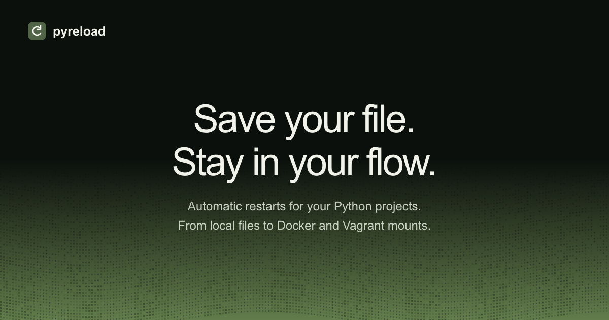

<p align="center"></p>

# Pyreload

Save your file. Stay in your flow. Pyreload restarts Python applications when
watched files change, with polling support for Docker, Vagrant, and network mounts.

[](https://github.com/smeltery/pyreload-cli/actions/workflows/ci.yml)
[](https://pypi.org/project/pyreload-cli/)
[](pyproject.toml)
[](package.json)
[](.flox/env/manifest.toml)
[](LICENSE)

[](https://smeltery.github.io/pyreload-cli/)

```bash
pip install pyreload-cli
pyreload app.py
pyreload app.py --polling  # For mounted filesystems
```

Watch selected patterns, ignore generated files, share JSON configuration, or run
shell commands with `--exec`. Type `rs` to restart or `stop` to exit.

[Website](https://smeltery.github.io/pyreload-cli/) ·
[Documentation](docs/README.md) ·
[CLI reference](docs/src/api/cli-reference.md) ·
[Contributing](CONTRIBUTING.md)

For development, run `flox activate` then `./setup-dev.sh`.
See [development](docs/src/development.md) and [releases](docs/src/releasing.md).
