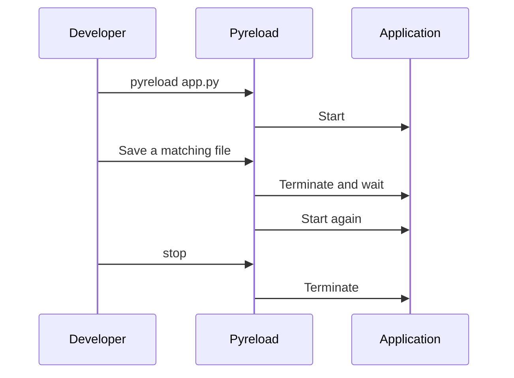

# Pyreload reference

Everything you need to run, configure, and control your watcher. Pyreload is a
local command-line tool: no account, API key, or hosted service is required.

## Commands

Run a Python script or a shell command whenever your source files change.

- [CLI reference](cli-reference.md): arguments, flags, and usage examples.
- [Interactive commands](../user-guide/commands.md): restart or stop from your terminal.

## Configuration

Keep project defaults in JSON and override them on the command line.

- [Configuration reference](config-reference.md): every supported key and its default.
- [Configuration files](../user-guide/config-files.md): file selection and precedence.

## Lifecycle

