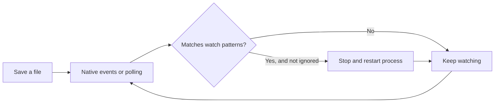

# Pyreload documentation

Pyreload watches local files and restarts your Python application when they change.
Use native filesystem events for local development, or polling for mounted folders.

## Start here

```bash
pip install pyreload-cli
pyreload app.py
```

[Install Pyreload](getting-started/installation.md), follow the
[quick start](getting-started/quick-start.md), or browse the [CLI reference](api/cli-reference.md).

## How it works



## Choose your workflow

- [Watch patterns](user-guide/watch-patterns.md): select files and directories.
- [Polling mode](user-guide/polling-mode.md): watch Docker, Vagrant, or network mounts.
- [Configuration](user-guide/config-files.md): share project defaults.
- [Troubleshooting](advanced/troubleshooting.md): diagnose missed changes and restart loops.
