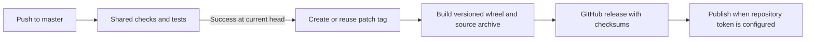

# Releases

## Automatic patch releases

A successful `ci` push run on `master` triggers automatic release tagging.
The workflow checks that the tested SHA is still the branch head, reuses an
existing version tag on reruns, or creates the next patch tag. It then explicitly
dispatches the release workflow because token-created tags do not trigger workflows.

## Version and artifacts

The release build sets both package metadata and `pyreload --version` from the
validated tag in the build checkout. It uploads a wheel, source archive, and
SHA256 checksums. Source version files are not committed back by automation.

## PyPI setup

Set the repository secret `PYPI_API_TOKEN` to enable PyPI publication. Without it,
the GitHub release is still built and the publish step explicitly reports that
PyPI is not configured. Never put tokens in files or workflow inputs.

## Retry

Dispatch `release.yml` with an existing `vMAJOR.MINOR.PATCH` tag. The workflow
validates the tag and its successful CI run before building. Existing release
assets are replaced on retry; PyPI uploads skip already-published files.
