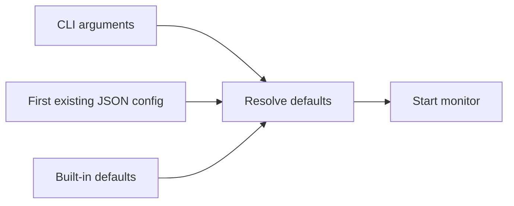

# Configuration files

Pyreload looks in the current working directory for `.pyreloadrc`, then
`pyreload.json`. Both use JSON. The first existing file wins; files are not merged.

## Project defaults

```json
{
  "watch": ["src/*.py", "config/*.yaml"],
  "ignore": ["*__pycache__*", "*.log"],
  "polling": true,
  "debug": false,
  "clean": false,
  "exec": false
}
```

The application command is always supplied on the command line.

## Precedence

Explicit watch and nonempty ignore CLI lists replace their corresponding config
lists. Boolean CLI flags enable features. There are no `--no-*` flags, so a true
config value must be disabled in the file.



Malformed JSON or unreadable files produce an error message and fall back to
CLI/default settings. Use valid JSON objects with the types in the
[configuration reference](../api/config-reference.md); values are not schema-validated.
