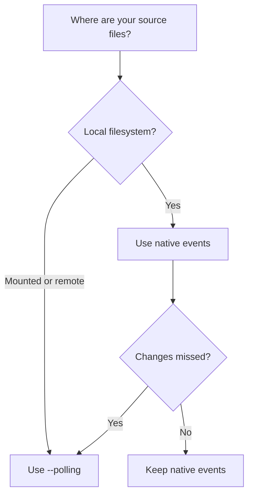

# Polling mode

Some mounted filesystems do not forward native file-change notifications.
Polling checks the filesystem periodically instead.

## Enable polling

```bash
pyreload app.py --polling
```

The `-p` shorthand and `"polling": true` configuration key are equivalent.
Pyreload uses Watchdog's default polling interval; there is no CLI interval setting.

## Choose an observer



Polling can use more CPU and detect changes later than native events. Watch
only the directories you need. See [Docker](../use-cases/docker.md) and
[Vagrant](../use-cases/vagrant.md) for examples.
